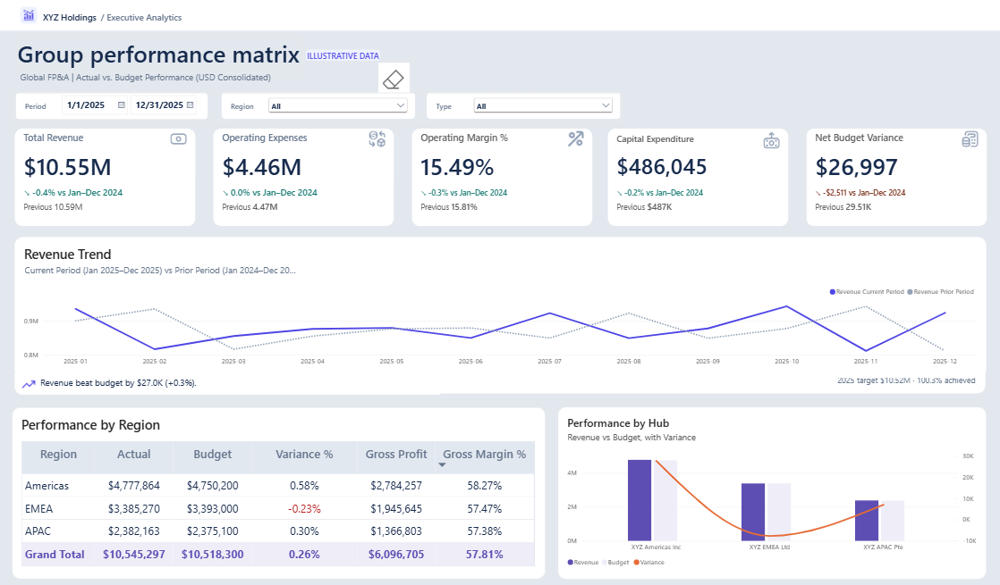
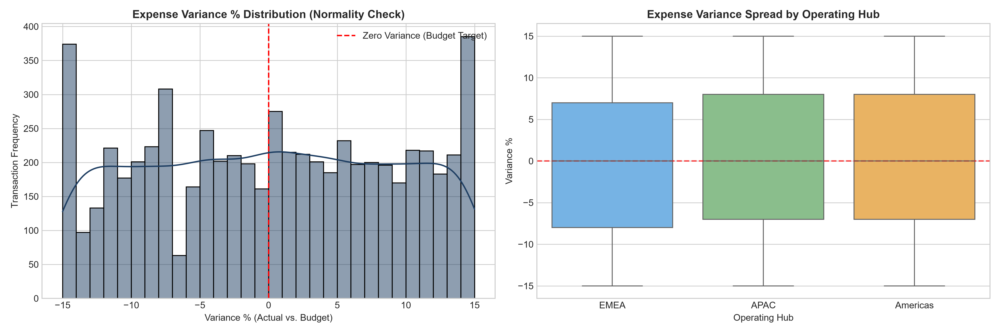
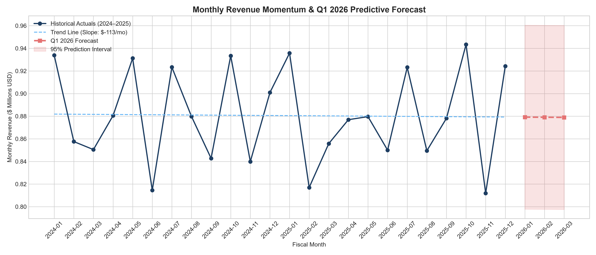

# Multi-Entity Financial Variance & Consolidation Analytics Platform

[](https://www.python.org/)
[](https://powerbi.microsoft.com/)
[](https://www.microsoft.com/sql-server)
[](#-financial-reconciliation--audit-gate)
[](LICENSE)

An enterprise Corporate FP&A data consolidation, econometric variance modeling, and executive intelligence platform built for multinational operations across **Americas, APAC, and EMEA**.

The platform bridges **Python data engineering**, **Kimball-modeled SQL data warehousing**, and **Executive Power BI analytics** to automate multi-entity financial consolidation, enforce zero-cent audit governance, model budgeting variance distributions, and forecast future revenue momentum.

---

## ⚡ Executive Impact & Key Performance Metrics

| Metric | Legacy Workflow (As-Is) | Platform Solution (To-Be) | Business Impact |
| :--- | :--- | :--- | :--- |
| **Month-End Close Latency** | 5 Business Days | **< 1 Second** | **99.9% faster** executive reporting turnaround |
| **Reconciliation Accuracy** | Manual spot-checks & formula risks | **Automated Zero-Cent Audit Gate** | **$0.00 Delta** (100% reconciled to the cent) |
| **Scale & Multi-Entity Scope** | Siloed Excel workbooks | **10,983 transactions across 3 Hubs** | Unified consolidation for Americas, EMEA, and APAC |
| **Predictive Intelligence** | Historical static tables | **Q1 2026 Regression Forecasting** | Projections with 95% econometric confidence intervals |
| **Executive Visibility** | Static monthly PDFs | **Interactive Power BI Dashboard** | Real-time margin decomposition & Period-over-Period DAX |

---

## 📊 Executive Visual Showcase

### 1. Executive Performance Dashboard (Power BI)
Dynamic Period-over-Period (PoP) comparison, Operating Margins (15.49%), Gross Margins (57.81%), and regional variance decomposition.



---

### 2. Statistical Variance & Normality Analysis (Python)
Empirical validation of budget accuracy and regional expense spread across 6,276 operating transactions.



---

### 3. Revenue Momentum & Q1 2026 Predictive Forecast (Python)
24-month linear regression baseline and Q1 2026 econometric projection with 95% confidence intervals.



---

## 📐 Data Model Architecture (Kimball Star Schema)

The platform organizes multi-entity financial transactions into an analytical **Star Schema**:

* **Dimension Tables:**
  * `DimDate`: 731 calendar days (2024–2025) with fiscal quarters, year-month keys, and weekday flags.
  * `DimLegalEntity`: Operating hubs (`Americas`, `EMEA`, `APAC`) mapped to local functional currencies (`USD`, `GBP`, `SGD`).
  * `DimGeneralLedger`: Chart of Accounts structured into standard GAAP/IFRS categories (`Revenue`, `Cost of Sales`, `OPEX`, `CAPEX`).
* **Fact Tables & Analytical Cubes:**
  * `FactFinancialTransactions`: 10,983 granular GL line items tracking daily actuals and budget allocations.
  * `FactMonthlyFinancialSummary`: 288 materialized monthly analytical records ($24\text{ months} \times 3\text{ regions} \times 4\text{ categories}$).

---

## 🛡️ Financial Reconciliation & Audit Gate

To eliminate spreadsheet formula corruption, the pipeline enforces a **hard programmatic audit gate** before data is committed for reporting:

```text
=================================================================
FINANCIAL AUDIT GATE: SOURCE-TO-TARGET RECONCILIATION
=================================================================
  Granular Transactions Actuals: $39,932,122.10
  Consolidated Cube Actuals:     $39,932,122.10
  Reconciliation Delta:          $0.00
  Budget Reconciliation Delta:   $0.00
  Status: [PASSED] 100% RECONCILED TO THE CENT ($0.00 DELTA)
=================================================================
```

---

## 🔬 Econometric Modeling & Statistical Insights

### 1. Budget Variance Normality & Bias Analysis
* **Statistical Finding:** Daily expense variances follow a bounded spread centered at **0.00%** with an interquartile range (IQR) spanning **-8% to +8%**.
* **Financial Insight:** Confirms that regional controllers across Americas, EMEA, and APAC do not systematically pad or sandbag budgets, demonstrating consistent fiscal governance.

### 2. Revenue Momentum & Q1 2026 Forecast
* **Annualized Baseline:** Flat trend slope (**-$113 / month**), proving that the business operates at a sustainable run-rate of **~$879K / month** ($10.55M annualized).
* **Q1 2026 Projections:** **$2.64M total quarterly revenue**:
  * **Jan 2026:** $879,149 (95% CI: $797,801 to $960,497)
  * **Feb 2026:** $879,036 (95% CI: $797,688 to $960,384)
  * **Mar 2026:** $878,923 (95% CI: $797,575 to $960,271)

---

## 📈 Power BI & DAX Formula Architecture

The executive dashboard implements custom DAX measures for dynamic time-intelligence:

* **Revenue Current Period:**
  ```dax
  Actual Revenue = 
  CALCULATE(
      SUM(FactFinancialTransactions[ActualAmount]),
      DimGeneralLedger[AccountCategory] = "Revenue"
  )
  ```
* **Prior Year Comparison (PoP):**
  ```dax
  Revenue Prior Period = 
  CALCULATE(
      [Actual Revenue],
      DATEADD(DimDate[FullDate], -1, YEAR)
  )
  ```
* **Operating Margin %:**
  ```dax
  Operating Margin % = 
  DIVIDE([Gross Profit] - [Actual OPEX], [Actual Revenue])
  ```

---

## 📂 Repository Directory Layout

```text
├── assets/
│   ├── dashboard_overview.png           # Power BI executive dashboard visual
│   ├── revenue_forecast.png             # Q1 2026 regression forecast visual
│   └── variance_distribution.png        # Normality and boxplot distribution visual
├── data/
│   ├── dim_date.csv                     # Fiscal calendar dimension (731 days)
│   ├── dim_general_ledger.csv           # Chart of accounts dimension (7 accounts)
│   ├── dim_legal_entity.csv             # Regional operating hubs dimension (3 hubs)
│   ├── fact_financial_transactions.csv  # 10,983 granular GL line items
│   └── fact_monthly_financial_summary.csv # Consolidated 288-row analytical cube
├── docs/
│   ├── Business Requirements Document.docx # Formal corporate FP&A specification
│   └── Multi-Entity Financial Variance...drawio.md # Architecture blueprint
├── powerbi/
│   └── Multi-Entity Financial Variance...pbix # Executive dashboard semantic model
├── src/
│   └── consolidation_engine.py         # Production Python ETL & audit engine
├── .gitignore                           # Git ignore definitions
├── FinanceThemePalette.json             # Power BI visual theme palette
└── README.md                            # Executive project documentation
```

---

## 🚀 Execution & Quickstart

### Prerequisites
* Python 3.10+
* `pandas`, `numpy`, `matplotlib`, `seaborn`

### 1. Run the Python Consolidation & Audit Pipeline
```bash
python src/consolidation_engine.py
```

### 2. Open the Power BI Executive Report
Open `powerbi/Multi-Entity Financial Variance & Consolidation Analytics Platform.pbix` in **Power BI Desktop** to interact with the executive dashboard.
